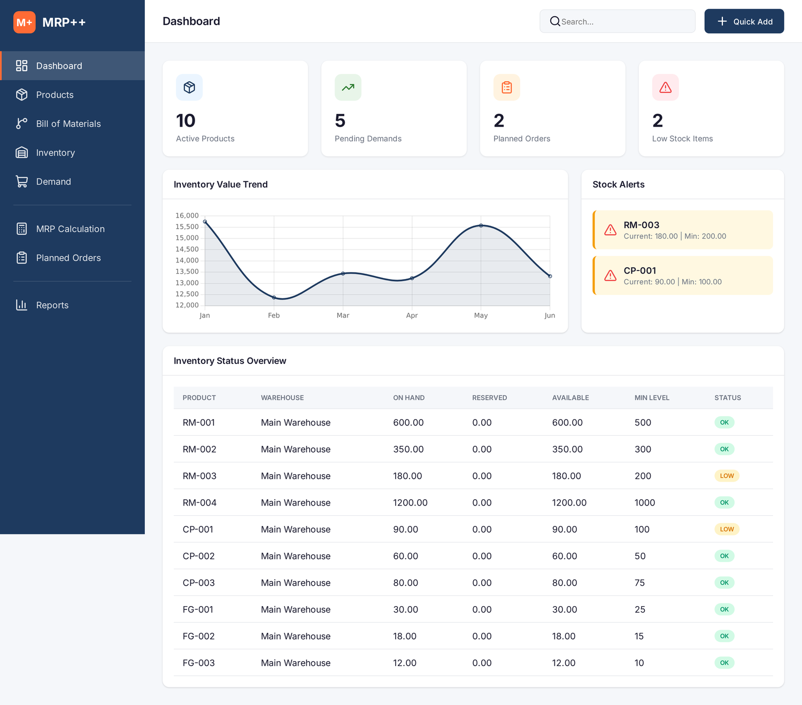
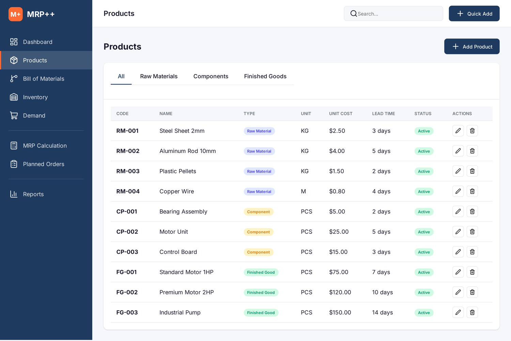
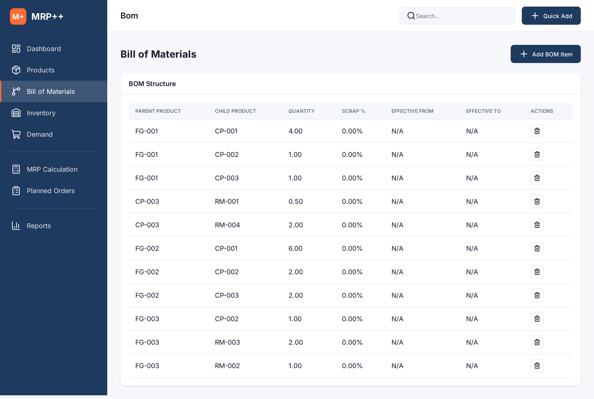
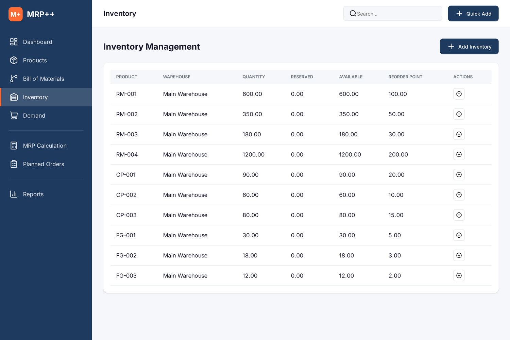
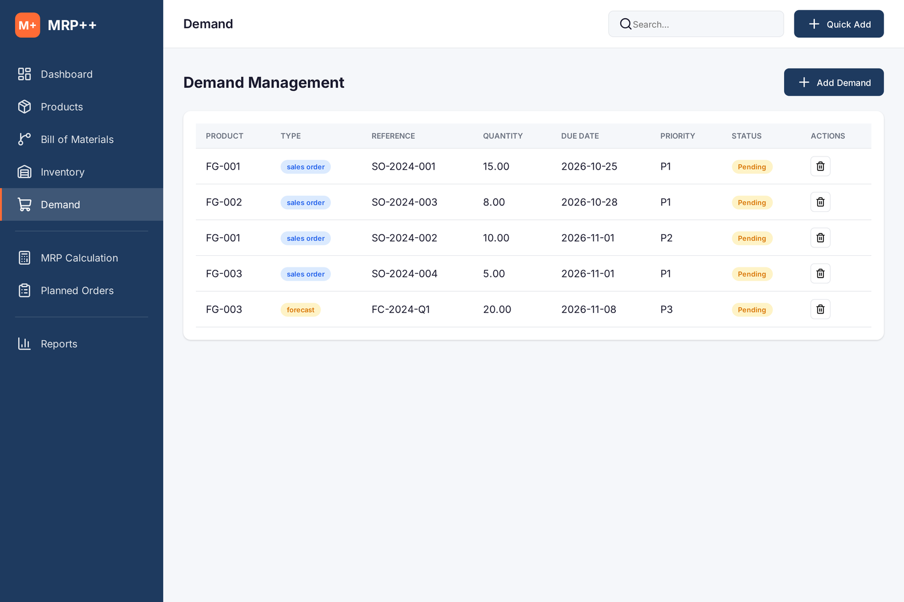
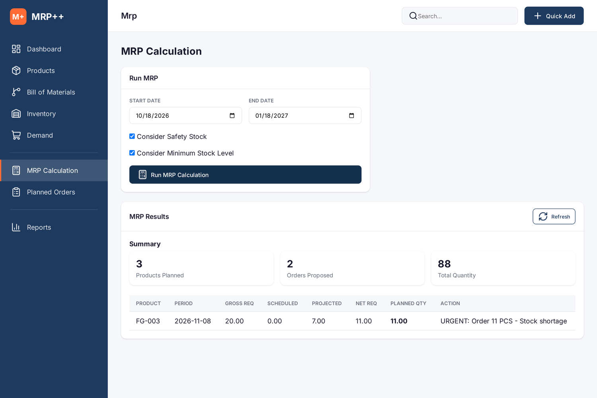
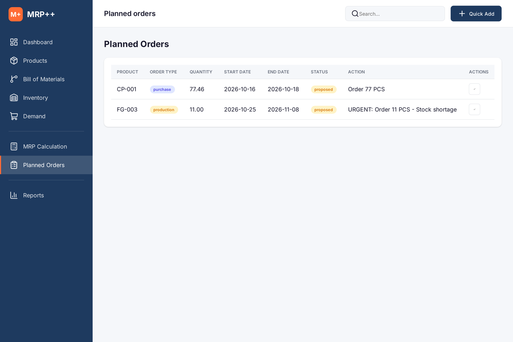
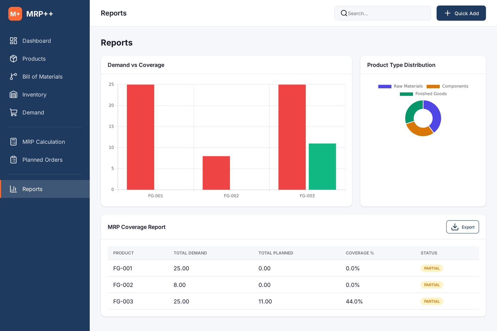
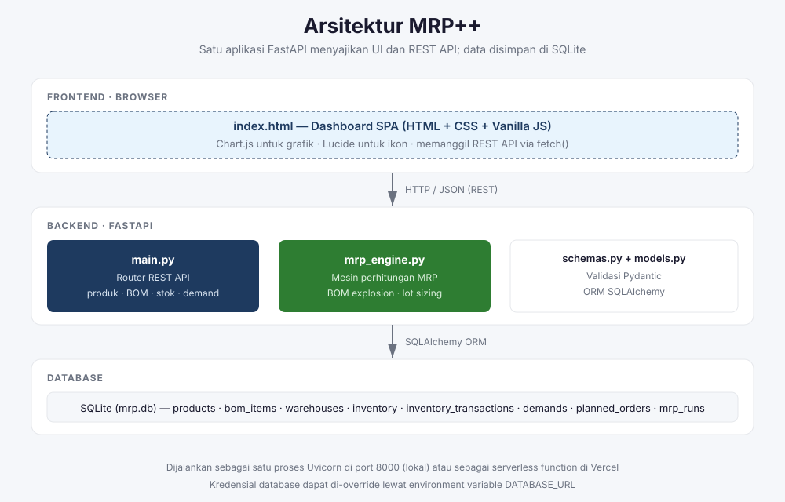
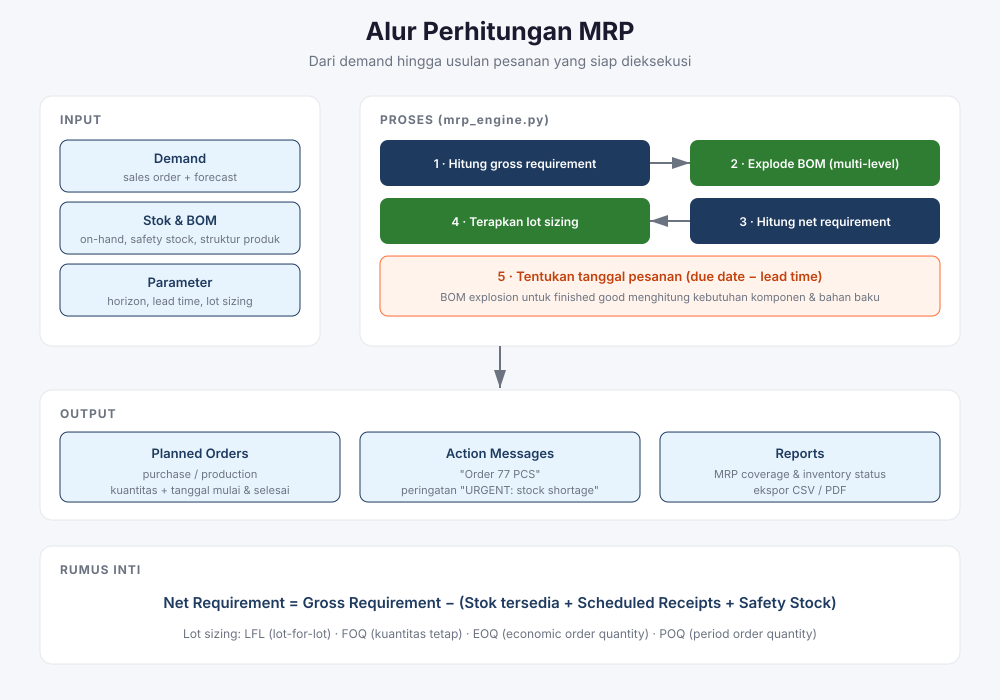

<div align="center">

# MRP++

**Material Requirements Planning Plus** — sistem perencanaan kebutuhan material untuk manufaktur: kelola produk, bill of materials (BOM) multi-level, stok, dan demand, lalu hitung kebutuhan bersih beserta usulan pesanan secara otomatis.

[](https://www.python.org/)
[](https://fastapi.tiangolo.com/)
[](https://www.sqlalchemy.org/)
[](https://www.sqlite.org/)
[](./LICENSE)

</div>



## Daftar Isi

- [Apa itu MRP++](#apa-itu-mrp)
- [Fitur Utama](#fitur-utama)
- [Arsitektur](#arsitektur)
- [Alur Perhitungan MRP](#alur-perhitungan-mrp)
- [Struktur Proyek](#struktur-proyek)
- [Menjalankan Aplikasi](#menjalankan-aplikasi)
- [Referensi API](#referensi-api)
- [Model Data](#model-data)
- [Catatan dan Batasan](#catatan-dan-batasan)
- [Lisensi](#lisensi)

## Apa itu MRP++

MRP (Material Requirements Planning) adalah cara standar di manufaktur untuk menjawab tiga pertanyaan: **apa** yang harus dipesan, **berapa banyak**, dan **kapan**.

MRP++ menjawab ketiganya dalam satu aplikasi web. Anda memasukkan demand (pesanan penjualan dan forecast), struktur produk (BOM), serta posisi stok. Aplikasi lalu menghitung kebutuhan bersih setiap produk, menerapkan aturan lot sizing dan lead time, dan menghasilkan usulan pesanan yang siap dieksekusi.

Aplikasi ini dirancang untuk **planner produksi, manajer produksi, tim pengadaan, dan pengelola gudang**.

## Fitur Utama

### 1. Dashboard

Ringkasan seluruh kondisi perencanaan dalam satu layar: jumlah produk aktif, demand yang belum terpenuhi, pesanan yang menunggu, item stok menipis, nilai persediaan, grafik tren, dan tabel status stok.


### 2. Master Produk

CRUD produk dengan atribut lengkap: kode, nama, unit, kategori, biaya satuan, minimum stok, safety stock, lead time, dan metode lot sizing. Produk dikelompokkan menjadi tiga jenis:

- **Raw Material** — bahan baku
- **Component** — komponen setengah jadi
- **Finished Good** — produk jadi



### 3. Bill of Materials (BOM)

Struktur BOM multi-level (hingga 5 tingkat) dengan kuantitas per unit induk, persentase scrap, serta masa berlaku. Aplikasi menolak penambahan BOM yang menciptakan **referensi melingkar** (circular reference).



### 4. Manajemen Persediaan

Stok per gudang beserta jumlah yang direservasi, kuantitas tersedia, dan reorder point. Setiap pergerakan stok dicatat sebagai transaksi (purchase, production, sale, adjustment, transfer) dan otomatis memperbarui saldo.



### 5. Manajemen Demand

Pencatatan pesanan penjualan dan forecast dengan tanggal jatuh tempo serta prioritas. Demand agregat per periode menjadi input utama perhitungan MRP.



### 6. Perhitungan MRP

Tentukan horizon perencanaan, lalu jalankan perhitungan. Mesin MRP menghitung gross requirement, melakukan ledakan BOM, menghitung net requirement, dan menerapkan lot sizing untuk menghasilkan usulan pesanan.



Metode lot sizing yang didukung:

| Metode | Kode | Cara kerja |
|--------|------|-----------|
| Lot for Lot | `lfl` | Pesan tepat sebesar kebutuhan |
| Fixed Order Quantity | `foq` | Pesan dalam kuantitas tetap |
| Economic Order Quantity | `eoq` | Kuantitas paling ekonomis dari biaya pesan dan simpan |
| Period Order Quantity | `poq` | Gabungkan kebutuhan beberapa periode |

### 7. Pesanan Terencana (Planned Orders)

Hasil perhitungan MRP berupa usulan pesanan pembelian atau produksi, lengkap dengan tanggal mulai, tanggal selesai, status, dan pesan tindakan seperti `Order 77 PCS` atau `URGENT: Order 11 PCS - Stock shortage`.



### 8. Laporan

Laporan status persediaan (dengan penanda `OK`, `LOW STOCK`, `BELOW SAFETY`, `NEGATIVE`) dan laporan cakupan MRP yang membandingkan total demand terhadap total pesanan terencana, plus ekspor CSV/PDF.



## Arsitektur

Satu proses FastAPI menyajikan halaman frontend sekaligus REST API. Frontend adalah satu berkas `index.html` berisi HTML, CSS, dan JavaScript tanpa framework.



## Alur Perhitungan MRP



Rumus inti yang dipakai mesin MRP:

```
Net Requirement = Gross Requirement
                  − (Stok tersedia + Scheduled Receipts + Safety Stock)

Tanggal pesan  = Tanggal kebutuhan − Lead time
```

## Struktur Proyek

```
mrp-plus/
├── main.py               # Aplikasi FastAPI: routing REST API + penyaji frontend
├── mrp_engine.py         # Mesin perhitungan MRP (BOM explosion, lot sizing, EOQ)
├── models.py             # Model ORM SQLAlchemy (tabel database)
├── schemas.py            # Skema validasi Pydantic (request & response)
├── database.py           # Koneksi engine, session, dan inisialisasi tabel
├── sample_data.py        # Skrip pengisi data contoh
├── index.html            # Frontend SPA (HTML + CSS + JavaScript)
├── api/index.py          # Handler serverless untuk Vercel
├── requirements.txt      # Dependensi Python
├── Dockerfile            # Konfigurasi image Docker
├── vercel.json           # Konfigurasi deploy Vercel
├── SPEC.md               # Spesifikasi aplikasi
└── docs/images/          # Gambar dokumentasi
```

## Menjalankan Aplikasi

### Prasyarat

- Python 3.11 atau lebih baru

### Menjalankan secara lokal

```bash
# 1. Siapkan virtual environment
python3 -m venv .venv
source .venv/bin/activate        # Windows: .venv\Scripts\activate

# 2. Pasang dependensi
pip install -r requirements.txt

# 3. Isi data contoh (opsional, tetapi disarankan untuk percobaan pertama)
python sample_data.py

# 4. Jalankan server
uvicorn main:app --reload --port 8000
```

Buka <http://localhost:8000>. Dokumentasi API otomatis tersedia di <http://localhost:8000/docs>.

Database SQLite (`mrp.db`) dibuat otomatis saat aplikasi pertama kali dijalankan. Lokasinya dapat diubah lewat environment variable `DATABASE_URL`, misalnya:

```bash
export DATABASE_URL="sqlite:///./data/mrp.db"
```

### Menjalankan dengan Docker

```bash
docker build -t mrp-plus .
docker run --rm -p 8000:8000 mrp-plus
```

### Menjalankan pengujian

```bash
pip install pytest
pytest test_api.py -v
```

`test_api.py` menjalankan 20 pengujian pada API dan mesin MRP: validasi enum, deteksi referensi melingkar BOM, ledakan BOM multi-level, konsistensi arah transaksi stok, perhitungan tren persediaan, serta isi berkas ekspor CSV.

### Data contoh

`sample_data.py` mengisi database dengan 2 gudang, 10 produk (bahan baku, komponen, produk jadi), 10 catatan persediaan, 11 baris BOM, dan 5 catatan demand. Skrip ini aman dijalankan berulang: bila data sudah ada, skrip berhenti tanpa menggandakan data.

## Referensi API

Seluruh endpoint berada di bawah prefiks `/api`.

### Produk

| Metode | Endpoint | Keterangan |
|--------|----------|------------|
| `GET` | `/api/products` | Daftar produk; filter `product_type`, `is_active`, `skip`, `limit` |
| `GET` | `/api/products/{id}` | Detail produk |
| `POST` | `/api/products` | Tambah produk |
| `PUT` | `/api/products/{id}` | Ubah produk |
| `DELETE` | `/api/products/{id}` | Nonaktifkan produk (soft delete) |
| `GET` | `/api/products/{id}/bom-tree` | Struktur BOM bertingkat dari suatu produk |

### Bill of Materials

| Metode | Endpoint | Keterangan |
|--------|----------|------------|
| `GET` | `/api/bom` | Daftar baris BOM; filter `parent_id`, `child_id` |
| `GET` | `/api/bom/{id}` | Detail baris BOM |
| `POST` | `/api/bom` | Tambah baris BOM (menolak referensi melingkar) |
| `POST` | `/api/bom/{id}/clone` | Gandakan baris BOM ke induk lain |
| `PUT` | `/api/bom/{id}` | Ubah baris BOM |
| `DELETE` | `/api/bom/{id}` | Hapus baris BOM |

### Gudang, Persediaan, dan Transaksi

| Metode | Endpoint | Keterangan |
|--------|----------|------------|
| `GET` | `/api/warehouses` | Daftar gudang |
| `GET` | `/api/warehouses/{id}` | Detail gudang |
| `POST` | `/api/warehouses` | Tambah gudang |
| `PUT` | `/api/warehouses/{id}` | Ubah gudang |
| `DELETE` | `/api/warehouses/{id}` | Hapus gudang (409 bila masih berisi persediaan) |
| `GET` | `/api/inventory` | Daftar persediaan; filter `product_id`, `warehouse_id`, `low_stock_only` |
| `GET` | `/api/inventory/{id}` | Detail catatan persediaan |
| `POST` | `/api/inventory` | Tambah atau perbarui persediaan |
| `PUT` | `/api/inventory/{id}` | Ubah persediaan |
| `GET` | `/api/inventory-transactions` | Daftar transaksi; filter `inventory_id`, `limit` |
| `POST` | `/api/inventory-transactions` | Catat transaksi dan perbarui saldo stok |

### Demand dan Pesanan Terencana

| Metode | Endpoint | Keterangan |
|--------|----------|------------|
| `GET` | `/api/demands` | Daftar demand; filter `product_id`, `is_fulfilled` |
| `GET` | `/api/demands/{id}` | Detail demand |
| `POST` | `/api/demands` | Tambah demand |
| `PUT` | `/api/demands/{id}` | Ubah demand |
| `DELETE` | `/api/demands/{id}` | Hapus demand |
| `GET` | `/api/planned-orders` | Daftar pesanan terencana; filter `product_id`, `status`, `start_date`, `end_date` |
| `GET` | `/api/planned-orders/{id}` | Detail pesanan terencana |
| `PUT` | `/api/planned-orders/{id}` | Ubah pesanan terencana |

### MRP, Laporan, dan Sistem

| Metode | Endpoint | Keterangan |
|--------|----------|------------|
| `POST` | `/api/mrp/run` | Jalankan perhitungan MRP |
| `GET` | `/api/mrp/runs` | Riwayat perhitungan MRP; parameter `limit` |
| `GET` | `/api/mrp/results` | Hasil MRP yang dikelompokkan per produk |
| `GET` | `/api/reports/inventory-status` | Laporan status persediaan |
| `GET` | `/api/reports/mrp-coverage` | Laporan cakupan MRP |
| `GET` | `/api/reports/inventory-trend` | Tren nilai persediaan per bulan; parameter `months` |
| `GET` | `/api/reports/summary` | Angka agregat untuk grafik laporan |
| `GET` | `/api/export/inventory-status` | Unduh laporan status persediaan (CSV) |
| `GET` | `/api/export/mrp-coverage` | Unduh laporan cakupan MRP (CSV) |
| `GET` | `/api/export/planned-orders` | Unduh pesanan terencana (CSV); filter `status` |
| `GET` | `/api/dashboard` | Ringkasan angka untuk dashboard |
| `GET` | `/api/dashboard/alerts` | Daftar peringatan stok menipis |
| `GET` | `/api/health` | Pemeriksaan kesehatan layanan |

Contoh menjalankan perhitungan MRP:

```bash
curl -X POST http://localhost:8000/api/mrp/run \
  -H "Content-Type: application/json" \
  -d '{
        "planning_horizon_start": "2026-10-18",
        "planning_horizon_end":   "2026-12-02",
        "use_safety_stock": true,
        "use_min_stock_level": true
      }'
```

## Model Data

| Tabel | Isi |
|-------|-----|
| `products` | Master produk: kode, nama, jenis, unit, biaya, minimum stok, safety stock, lead time, metode lot sizing |
| `bom_items` | Relasi induk–anak beserta kuantitas, scrap, versi, dan masa berlaku |
| `warehouses` | Master gudang |
| `inventory` | Saldo stok per produk per gudang, termasuk jumlah direservasi dan reorder point |
| `inventory_transactions` | Riwayat pergerakan stok |
| `demands` | Pesanan penjualan dan forecast |
| `planned_orders` | Usulan pesanan hasil perhitungan MRP |
| `mrp_runs` | Catatan setiap kali perhitungan MRP dijalankan |

## Catatan dan Batasan

- **Tanpa autentikasi.** CORS dibuka untuk semua origin dan tidak ada lapisan login. Aplikasi ini ditujukan untuk pemakaian internal, demo, atau pengembangan, bukan untuk dipublikasikan langsung ke internet.
- **Produk dihapus secara soft delete.** Menghapus produk hanya menandainya tidak aktif agar riwayat BOM dan demand tetap utuh. BOM, demand, dan gudang dihapus permanen.
- **Gudang hanya dapat dihapus saat kosong.** Endpoint `DELETE /api/warehouses/{id}` menolak penghapusan (HTTP 409) selama gudang masih memiliki catatan persediaan.
- **Deploy Vercel bersifat opsional.** `api/index.py` sudah diperbaiki dan memakai `httpx.ASGITransport` untuk menjembatani kontrak WSGI Vercel ke aplikasi ASGI. Berkas SQLite diarahkan ke `/tmp` karena sistem berkas Vercel bersifat read-only. Untuk pemakaian nyata, jalankan lewat Uvicorn atau Docker.
- **SQLite berbasis satu berkas.** Cocok untuk satu instans. Untuk beberapa instans atau beban tulis tinggi, gunakan database lain lewat `DATABASE_URL`.
- **Tren nilai persediaan direkonstruksi.** Tidak ada snapshot historis, jadi grafik tren dihitung dengan memutar balik riwayat transaksi dari nilai saat ini. Akurasinya bergantung pada kelengkapan log transaksi.
- **Nilai persediaan memakai biaya standar.** Valuasi memakai `unit_cost` produk, belum mendukung FIFO/average cost per lot.

## Lisensi

Proyek ini dilisensikan di bawah [MIT License](./LICENSE).
